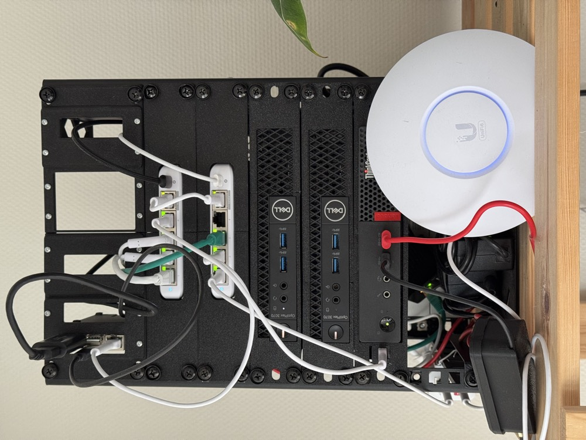

# HomeOps

[](https://stats.uptimerobot.com/K0gMkYB4jR)


Infrastructure as Code repository for home infrastructure management.



## Repository Structure

```
homeops/
├── talos/              # Talos Kubernetes cluster configurations
│   └── talos1018/      # Cluster-specific config and patches
├── kubernetes/         # Flux CD GitOps manifests
│   ├── apps/           # Everything: platform (Cilium, cert-manager, Longhorn) and apps
│   │   └── talos1018/  # Cluster applications
│   ├── clusters/       # Flux configurations
│   │   └── talos1018/
│   │       ├── flux-system/
│   │       └── apps.yaml
│   └── components/     # Shared Kustomize components
├── scripts/            # Automation and validation scripts
├── docs/               # Documentation and assets
└── .github/            # CI/CD workflows
```

## Projects

### Talos1018 Cluster

A 3-node Kubernetes cluster running on Talos Linux. For detailed setup and configuration, see [talos/talos1018/README.md](talos/talos1018/README.md).

- Control plane: 3 nodes
- Network: Cilium CNI (native routing) with L2 announcements and Gateway API
- Dual-stack, IPv6-primary (ULA `fd00:1018:0:5:10:18:6:90-93`, IPv4 `10.18.6.90-93`)

### Platform

One Flux `apps` Kustomization applies everything; ordering is per-component `dependsOn`:

- Gateway API CRDs, then Cilium CNI (native routing, L2 announcements, Gateway API for all HTTPRoutes) and cert-manager with Let's Encrypt
- Longhorn storage with daily backups to Backblaze B2, after Cilium and cert-manager
- Applications deploy in parallel; those with a Longhorn volume wait for Longhorn via `dependsOn`

### Kubernetes GitOps

GitOps with Flux CD. See [kubernetes/README.md](kubernetes/README.md) for details.

- Continuous deployment via Flux CD
- Secret management with SOPS + age
- Automated validation via GitHub Actions

## Prerequisites

- `talosctl`
- `kubectl`
- `helm`
- `flux` CLI
- `sops` (for secret management)

## Getting Started

1. Clone the repository:
```bash
git clone https://github.com/fmurodov/homeops.git
cd homeops
```

2. Navigate to the desired project directory and follow the project-specific README instructions.

## Development

### Git Pre-Commit Hook

To automatically validate configs before committing:

```bash
cp scripts/pre-commit .git/hooks/pre-commit
```

This will run `./scripts/validate.sh` before each commit. To bypass: `git commit --no-verify`
